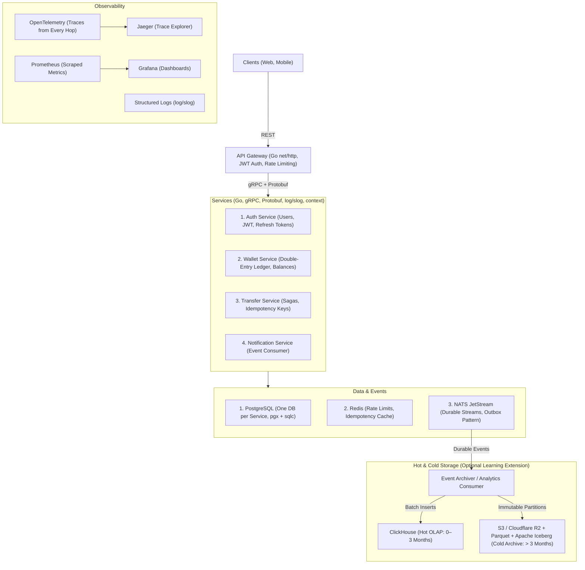

# Payments Platform Architecture

A payments platform: wallets, transfers, events, and observability.

## High-Level Diagram

## Request Flow

`Clients (Web, Mobile)` → `API Gateway (REST, JWT Auth, Rate Limiting)` → `Services (gRPC + Protobuf)`

## Services (gRPC)

1. **Auth Service** — Users, JWT, and refresh tokens
2. **Wallet Service** — Double-entry ledger and balances
3. **Transfer Service** — Sagas and idempotency keys
4. **Notification Service** — Consumer events

## Tech Stack

### Services
- **Language & Standard Library:** Go (`net/http`, `log/slog`, `context`)
- **Inter-Service RPC:** gRPC with Protobuf

### Data & Events
- **PostgreSQL:** Primary OLTP store (one database per service); powers the double-entry ledger using `pgx` and `sqlc`
- **Redis:** Rate limiting and idempotency cache
- **NATS JetStream:** Durable event streams using the transactional outbox pattern

### Observability
- **OpenTelemetry:** Distributed traces propagated across every hop
- **Jaeger:** Trace visualization and exploration
- **Prometheus:** Scraped service and infrastructure metrics
- **Grafana:** Metrics dashboards and alerting
- **Structured Logging:** JSON/key-value logs via Go's `log/slog`

### Ship It (Build, Test & Deploy)
- **Docker:** Local infrastructure images and containerized development
- **GitHub Actions:** CI pipeline running on every push
- **k6:** Load and stress testing
- **Kubernetes:** Container orchestration and deployments (Part 2)

## Extended Architecture: Hot & Cold Storage (OLAP + Lakehouse)

### Why This Fits a Banking / Payments Platform
- **Keep OLTP and OLAP separate:** Live balances, double-entry ledger writes, and transfer Sagas require strict ACID transactions, so **PostgreSQL** (`pgx` + `sqlc`) must always remain the source of truth.
- **Why Hot Storage (ClickHouse, 0–3 months) helps:** Heavy analytical queries (transfer volume per minute, user spending summaries, velocity/fraud checks, failed Saga rates) slow down PostgreSQL. ClickHouse handles high-throughput analytical queries over recent data without touching transactional latency.
- **Why Cold Storage (S3 / R2 + Parquet + Apache Iceberg, > 3 months) helps:** Financial systems require long-term audit and compliance retention (5–10+ years). Archiving historical events into Iceberg/Parquet avoids bloating PostgreSQL indexes, backups, and `VACUUM` overhead while keeping old records queryable on demand.

### Ideal Structure

Because events are already published to **NATS JetStream** via the transactional outbox pattern, hot and cold storage plug in asynchronously without affecting the hot transfer path:

1. **OLTP Source of Truth — PostgreSQL**
   - Handles live balances, active Sagas, and recent double-entry ledger records.
2. **Event Bus — NATS JetStream**
   - Publishes immutable, finalized domain events (`LedgerEntryPosted`, `TransferCompleted`, `TransferFailed`, `AuthEvent`).
3. **Analytics / Archiver Consumer — Go Worker**
   - Subscribes to NATS JetStream and writes events in batches so transfer latency stays untouched.
4. **Hot OLAP Storage (0–3 Months) — ClickHouse**
   - Uses `MergeTree` / `ReplacingMergeTree` (deduplicated on `event_id`), partitioned by `toYYYYMM(occurred_at)`.
   - Drops expired partitions via TTL (`INTERVAL 90 DAY`) once archived to cold storage.
5. **Cold Lakehouse Storage (> 3 Months) — MinIO (Local) / S3 or Cloudflare R2 + Parquet + Apache Iceberg**
   - Stores immutable historical events and ledger snapshots as **Parquet** files managed by **Apache Iceberg**.
   - Partitioned by `month(occurred_at)` and sorted by `(account_id, occurred_at)` so single-account statement exports and audit queries scan minimal data.
   - Queryable on demand via DuckDB, Trino, or ClickHouse external/Iceberg table engines.

### Banking-Specific Rules to Follow
- **Append only finalized events:** Never stream uncommitted Saga steps as settled ledger truth.
- **Deduplicate on `event_id`:** NATS JetStream delivers at-least-once; deduplicate in ClickHouse and write atomic partitions to Iceberg.
- **Protect PostgreSQL ledger integrity:** If pruning old rows from PostgreSQL, keep periodic balance checkpoints/snapshots so double-entry verification always holds.
- **Mask or tokenize PII:** Avoid storing raw sensitive fields in analytics buckets without encryption and access controls.

### Learning Tip (Suggested Build Order)
1. **Core Platform (Part 1):** Build and load-test (`k6`) the Go microservices, PostgreSQL double-entry ledger, Redis, NATS JetStream outbox, and full observability (OpenTelemetry → Jaeger, Prometheus → Grafana, `log/slog`) with Docker and GitHub Actions CI.
2. **Orchestration (Part 2):** Deploy the core services to **Kubernetes**.
3. **Hot & Cold Storage Extension:** Attach the Go Analytics/Archiver consumer to **NATS JetStream** to populate **ClickHouse** (hot) and **MinIO/S3/R2 + Parquet + Apache Iceberg** (cold) without changing the core transaction services.
